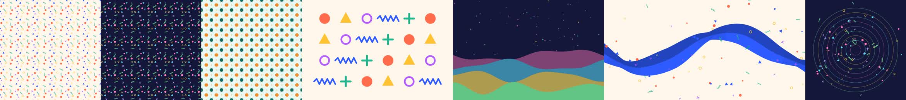

# svg-stock-pipeline

Code-generated vector stock assets, plus an export pipeline that turns any SVG into a marketplace-ready upload set: **EPS (100 % vector, PostScript Level 3) + JPG preview + metadata CSV**. The hard part is that EPS has no transparency.



*The demo campaign `geo-confetti`: 7 SVGs, each a different composition, from one theme script. All 7 exported "ready" in 22 s.*

## Two parts

### 1. Generator (`generator/`)

A tiny, dependency-free SVG toolkit:
- seeded RNG;
- gradients de-duplicated per document;
- `tile()` for seamless lattices and `scatterTile()` for seamless random scatter with minimum spacing;
- element sheets, layered hills, two-tone twisting ribbons, Catmull-Rom smoothing.

A **theme script** decides its own asset mix and returns a list of assets. The runner then:
- numbers the files and writes `upload/*.svg`;
- builds keywords (lead + per-asset + base + format, de-duplicated, max 49);
- writes `metadata.csv`;
- **fails the build** if a title is over 200 characters, there are more than 49 keywords, or an artboard is under 15 MP.

Every artboard is clipped, because stock reviewers reject objects hanging outside it.

```bash
node generator/build.mjs examples/geo-confetti geo-confetti   # SVG + metadata.csv
zsh generator/render.sh "$PWD/examples/geo-confetti"          # JPEG previews (Chrome headless + sips, macOS)
zsh generator/sheet.sh  "$PWD/examples/geo-confetti"          # contact sheet
```

### 2. Export pipeline (`pipeline/`)

```bash
node pipeline/export.mjs <svgDir> <outDir> --meta metadata.csv [--model "Claude"] [--only a,b] [--keep-work] [--no-preview]
```

| Marketplace requirement | How the pipeline meets it |
|---|---|
| EPS, RGB, 0.5–80 MB | Chrome prints a vector PDF at artboard size → Poppler `pdftops -eps -level3` |
| Clean vector, no raster | Transparency is **flattened first**. Every EPS is re-distilled and `pdfimages` must find **0 images** |
| Same-name JPG, 2,000–10,000 px, ≥ 4 MP, ≥ 1.5 MB | Rendered from the flattened SVG. Quality and size step up until ≥ 1.5 MB; an sRGB profile is embedded |
| CSV `File name;Title;Keywords;Prompt;Model` | Max 20 keywords including the AI label, format words removed from titles |

**Flattening transparency without rasterising.** This runs in headless Chrome over the DevTools Protocol (`pipeline/cdp.mjs`, using Node's built-in WebSocket and no npm packages).
- **Semi-transparent solids.** The backdrop colour is recovered from the original render with `B = (P − a·C) / (1 − a)`, sampled only where that element is on top. The element is then replaced by the opaque colour `a·C + (1 − a)·B`. On a uniform backdrop the result is pixel-identical.
- **Fading gradients (glows).** The backdrop is read from a render with the element hidden, and every gradient stop is blended into it.
- **Group opacity** is multiplied down to the children.
- **Hard-edge detection.** A transparent element over a non-uniform backdrop is checked along its outline. If ≥ 25 % of edge samples show a new colour jump, or the overall diff is too high, the file goes to `_review/` instead of shipping a visible seam.
- **Lint.** These are rejected: `<text>`, `<image>`, `<filter>`, `<mask>`, blend modes, fonts, rgba, and any opacity that is still left over.
- **DOS-EPS preview.** A 1,500 px TIFF preview is embedded the same way Illustrator does it, so thumbnails show up in file browsers.

**Tried and rejected:**
- Ghostscript `eps2write` writes Level 2 only. It rasterised every page with transparency: one test came out as a 38 MB EPS holding a single 45,000 px image.
- Slicing glows into clipped horizontal bands looked fine as JPG but showed hairlines in two different EPS renderers.

**Results.** On a real batch of 360 generator SVGs:

| | Count |
|---|---:|
| Ready (EPS 100 % vector, JPG ≥ 1.5 MB, sRGB) | **234** |
| Review (transparent glow over a changing backdrop) | 126 |
| Failed | 0 |

The review cases led to a design rule for generators: compute opaque colours (`mix(colour, background, alpha)`) instead of using opacity. The demo theme follows that rule, which is why it ships 7/7 ready.

Requirements: Node ≥ 22, Google Chrome, Poppler (`pdftops`, `pdfimages`), Ghostscript (`gs`, for verification). The preview scripts use `sips` (macOS).

## Writing a theme

```js
// generator/themes/my-theme.mjs
import { rect, scatterTile, G } from '../kit.mjs';
export const theme = { lead: 'main keywords', base: 'shared keywords' };
export const build = () => [
  () => ({ slug: 'my-pattern-seamless', W: 6000, H: 6000, color: 'blue',
           svg: rect(6000, 6000, '#fff') + scatterTile(6000, 6000, 1000, 12, 1, (x, y) => G(x, y, 1, '<circle r="60" fill="#2D5BFF"/>')),
           title: 'Seamless polka dot pattern, blue', kw: 'polka dot, seamless pattern' }),
];
```

## License

MIT. Upload to any marketplace is meant to stay manual: check each platform's AI-content and originality rules.
